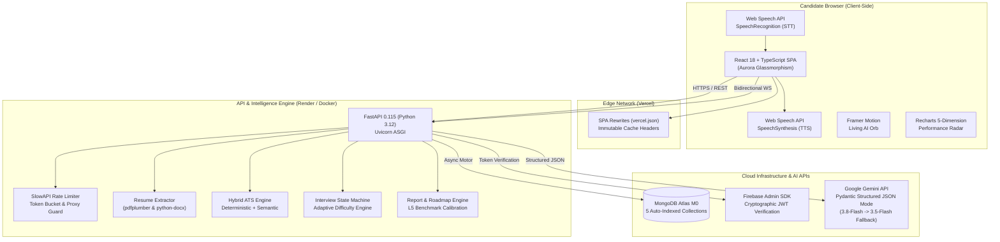

# InterviewIQ

<div align="center">


### *"Get grilled by AI. Get hired by humans."*

**AI Interview Preparation & Resume Analysis Platform**  
*Final-Year B.E. Major Project • Visvesvaraya Technological University (VTU)*

</div>

---

## 📌 Executive Summary

**InterviewIQ** bridges the critical gap between automated applicant screening and real-world technical hiring. Engineering candidates often face two insurmountable hurdles: passing opaque Applicant Tracking System (ATS) resume filters and performing effectively under live technical grilling.

InterviewIQ provides an integrated, end-to-end platform:
1. **Hybrid ATS Engine:** Parses PDF/DOCX resumes and computes a deterministic mathematical score alongside semantic gap analysis.
2. **Resume-Aware Voice AI Interview Room:** Conducts real-time, hands-free technical interviews with browser-native speech processing and an animated multi-state AI Orb.
3. **Adaptive State Machine:** Dynamically escalates or eases interview difficulty based on rolling answer quality.
4. **Post-Interview Learning Loop:** Generates a 5-dimension performance radar chart comparing candidate responses against Senior L5 industry standards, accompanied by an algorithmic milestone career roadmap.

---

## 🏗 System Architecture



---

## ✨ Core Engineering Features

### 1. Hybrid ATS Resume Analyzer
- **Deterministic Mathematical Scoring Formula:**
  $$\text{ATS Score} = (\text{KeywordMatch} \times 0.35) + (\text{Sections} \times 0.20) + (\text{Metrics} \times 0.15) + (\text{ActionVerbs} \times 0.15) + (\text{Formatting} \times 0.15)$$
- **Scanned Document Detection:** Rejects empty or image-only scanned PDFs ($<50$ characters).
- **Gemini Semantic Extraction:** Maps skills, projects, and generates prioritized, high-impact improvements.

### 2. Real-Time Voice AI Mock Interview Room
- **Native Browser Speech-to-Text:** Zero external API fees and zero latency using `window.SpeechRecognition`.
- **Natural Text-to-Speech:** Automatically voices interview questions via `window.speechSynthesis`.
- **Living AI Orb Presence:** Animated multi-state avatar (`idle`, `speaking`, `listening`, `thinking`) with dynamic audio frequency visualizer.
- **Hands-Free / Text Toggle:** Seamless transition between full voice mode and manual text mode with one-click sample answers for fast evaluation demos.

### 3. Adaptive Difficulty State Machine
- Calibrates candidate answers across a **5-Dimension Rubric**:
  1. **Relevance** ($1-10$)
  2. **Technical Accuracy** ($1-10$)
  3. **Clarity & Articulation** ($1-10$)
  4. **Architectural Depth & Trade-offs** ($1-10$)
  5. **Confidence & Tone** ($1-10$)
- **Dynamic Difficulty Escalation:**
  - Rolling Score $\ge 7.5 \implies$ Escalates to **Hard** (System design, edge cases, scalability)
  - Rolling Score $\le 4.5 \implies$ Eases down to **Easy** (Core fundamentals)
  - Otherwise maintains **Medium**
- **Single-Turn Combined Inference:** Evaluates the previous answer AND formulates the next question in 1 Gemini call, cutting latency and API quota consumption by $50\%$.

### 4. Comprehensive Performance Report & Career Roadmap
- **Recharts 5-Dimension Radar Chart:** Visual comparison of Candidate Performance against the Senior L5 Industry Benchmark polygon.
- **Personalized Algorithmic Career Roadmap:** Synthesizes a 4-milestone curriculum with step numbers, task checklists, curated references, and capstone mini-projects targeting the candidate's exact gaps.
- **Candidate Analytics Dashboard:** Visualizes historical score progression over time via smooth neon cyan Area Charts alongside recent interview archives.
- **PDF Export Support:** Native print styling (`@media print`) for institutional report generation.

---

## 🛠 Tech Stack Specification

| Component | Technology | Version | Purpose |
| :--- | :--- | :--- | :--- |
| **Backend Framework** | FastAPI | `0.115.0+` | High-performance asynchronous REST & WebSocket API |
| **Language Runtime** | Python | `3.12.14` | Homebrew universal2 binary with pre-compiled wheels |
| **Data Contracts** | Pydantic | `v2.7+` | Strict schema validation & Rust-based serialization |
| **Database Driver** | Motor (Async MongoDB) | `3.4.0+` | Non-blocking database transactions on asyncio |
| **Cloud Database** | MongoDB Atlas | `M0 Cluster` | 5 indexed collections (`users`, `resumes`, `sessions`, `answers`, `reports`) |
| **Primary AI Engine** | Google Gemini | `gemini-3.8-flash` | Structured JSON generation with Pydantic grammar decoding |
| **Fallback AI Engine** | Google Gemini | `gemini-3.5-flash` | Multi-tier failover chain with exponential backoff |
| **Authentication** | Firebase Admin SDK | `6.5.0+` | RSA cryptographic JWT token verification |
| **Rate Limiter** | SlowAPI | `0.1.10+` | Token bucket endpoint protection |
| **Frontend Framework** | React | `18.3+` | Single Page Application component tree |
| **Build Tooling** | Vite | `5.4+` | Sub-second HMR & Rollup tree-shaking |
| **Type Safety** | TypeScript | `5.5+` | Strict type validation across all UI services |
| **Styling & Theme** | Tailwind CSS | `3.4+` | Aurora Glassmorphism (`#0B0F19`, backdrop blur) |
| **Animations** | Framer Motion | `11.5+` | Physics-based spring animations for AI Orb |
| **Data Visualization** | Recharts | `2.13+` | Declarative SVG Radar & Area charts |
| **Containerization** | Docker | `Multi-Stage` | Lightweight $<180\text{MB}$ unprivileged production image |

---

## 📂 Repository Structure

```
interviewiq/
├── backend/
│   ├── app/
│   │   ├── middleware/      # Rate limiting (SlowAPI)
│   │   ├── models/          # Pydantic schemas (resume, session, report)
│   │   ├── prompts/         # Calibrated Gemini prompt templates
│   │   ├── routes/          # REST & WebSocket API endpoints
│   │   ├── services/        # ATS engine, Gemini client, session manager, report engine
│   │   ├── config.py        # Pydantic settings & environment configuration
│   │   ├── database.py      # Motor async Atlas connection & index manager
│   │   ├── dependencies.py  # Firebase Admin token verification dependency
│   │   └── main.py          # FastAPI application entrypoint & lifespan hooks
│   ├── tests/               # 25 automated pytest suites (Auth, DB, Gemini, Health, Interview, Report, E2E)
│   ├── Dockerfile           # Multi-stage production container
│   ├── render.yaml          # Render blueprint specification
│   └── requirements.txt     # Pinned Python dependencies
├── frontend/
│   ├── src/
│   │   ├── components/      # UI primitives (Card, Badge, Button, ScoreGauge) & AI Orb / Visualizer
│   │   ├── context/         # AuthContext (Firebase Google OAuth & Email)
│   │   ├── hooks/           # useSpeechRecognition & useSpeechSynthesis
│   │   ├── pages/           # Landing, Resume Analyzer, Interview Room, Report, Roadmap, Dashboard
│   │   ├── services/        # Axios API clients & WebSocket connection managers
│   │   └── App.tsx          # React Router v6 & ErrorBoundary layout
│   ├── Dockerfile           # Multi-stage Nginx production container
│   ├── nginx.conf           # SPA routing & security headers
│   └── vercel.json          # Vercel SPA rewrite & caching manifest
├── docker-compose.yml       # Monorepo containerized local production stack
├── DEPLOYMENT.md            # Production cloud rollout guide (Vercel + Render)
├── VIVA_PREP.md             # 25 Viva examination Q&A + 5-minute live demo script
└── PROGRESS.md              # 100% completed project tracking milestone
```

---

## 🚀 Quick Start Guide

### 1. Prerequisites
- **Python:** `3.12+`
- **Node.js:** `18+`
- **MongoDB Atlas Cluster** (Free M0)
- **Firebase Project** (Web App + Service Account Key)
- **Google AI Studio API Key**

### 2. Backend Setup
```bash
cd backend
python3 -m venv venv
source venv/bin/activate
pip install -r requirements.txt

# Configure environment
cp .env.example .env
# Ensure .env contains MONGODB_URI and GEMINI_API_KEY
# Ensure backend/serviceAccountKey.json is placed in backend/

# Start development server
uvicorn app.main:app --reload --port 8000
```
Backend API will be live at `http://127.0.0.1:8000`.  
Interactive Swagger docs: `http://127.0.0.1:8000/docs`.

### 3. Frontend Setup
```bash
cd frontend
npm install

# Configure environment
cp .env.example .env
# Ensure VITE_API_BASE_URL=http://localhost:8000 and Firebase web keys are set

# Start development server
npm run dev
```
Frontend will be live at `http://localhost:5173`.

### 4. Running via Docker Compose
```bash
# Build and run complete production stack locally
docker compose up --build
```

---

## 🧪 Automated Test Verification

Execute the comprehensive test suite verifying all 25 unit and integration tests:

```bash
cd backend
./venv/bin/pytest tests/
```

Test Results Breakdown:
- `test_health.py` (2 tests): Active ping & configuration verification.
- `test_database.py` (2 tests): Atlas connectivity and B-Tree indexes verification.
- `test_auth.py` (3 tests): Firebase cryptographic token verification & user sync.
- `test_gemini.py` (2 tests): Pydantic structured output mode & fallback chain.
- `test_resume.py` (6 tests): Text extraction, scanned PDF rejection, deterministic ATS math.
- `test_interview.py` (5 tests): Multi-turn state machine & adaptive difficulty.
- `test_report.py` (4 tests): 5-dimension report generation & career roadmap synthesis.
- `test_e2e_flow.py` (1 test): Complete end-to-end integration pipeline.

---

## 📚 Academic Examination Resources

- [**VIVA_PREP.md**](file:///Users/hithesh/Documents/majorProject/VIVA_PREP.md): **25 Exhaustive Viva Questions & High-Scoring Model Answers** + **5-Minute Live Evaluator Demo Script**.
- [**DEPLOYMENT.md**](file:///Users/hithesh/Documents/majorProject/DEPLOYMENT.md): Production cloud deployment blueprint for Vercel and Render.
- [**PROGRESS.md**](file:///Users/hithesh/Documents/majorProject/PROGRESS.md): Step-by-step 12-phase project completion chronicle.

---

## 📄 License
This project is developed for academic evaluation under the Visvesvaraya Technological University (VTU) Bachelor of Engineering curriculum. Released under the [MIT License](LICENSE).
